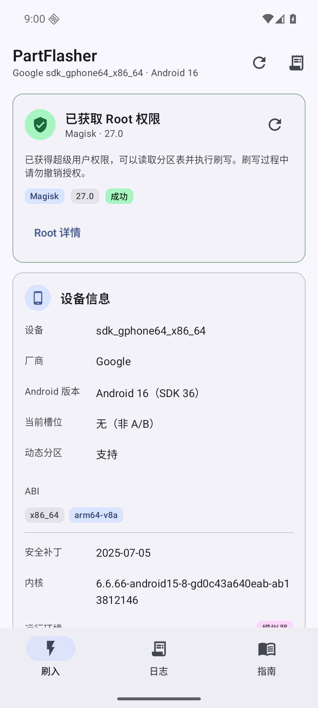
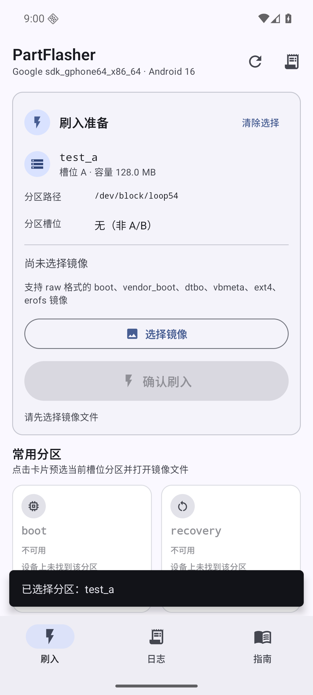
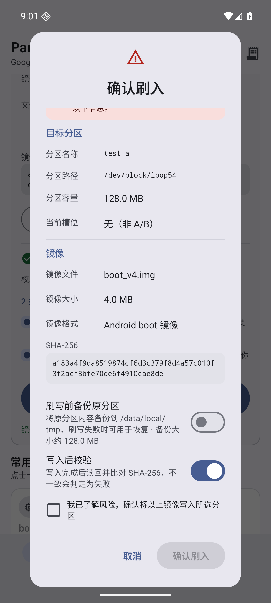
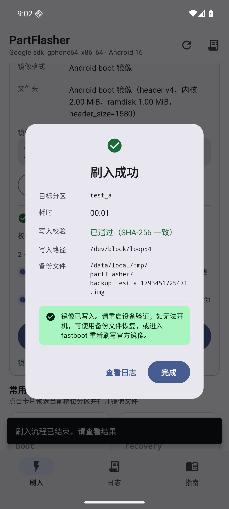
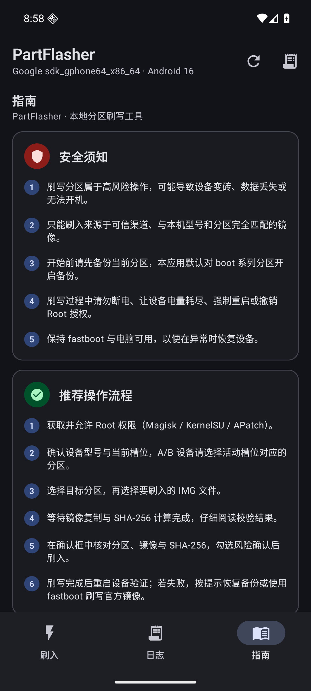
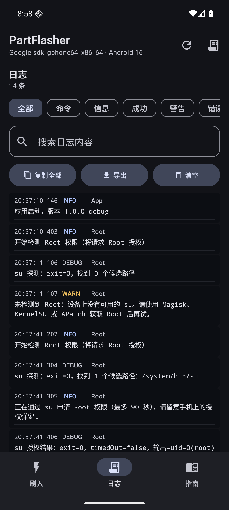

# PartFlasher · Android 分区刷写器

[](https://github.com/hoshino114/partflasher/actions/workflows/android.yml)
[](https://github.com/hoshino114/partflasher/releases/latest)
[](LICENSE)

> 仓库：[github.com/hoshino114/partflasher](https://github.com/hoshino114/partflasher)


一款面向已 Root Android 设备的本地 IMG 分区刷写工具。启动后申请 Root 权限，自动读取本机分区列表，校验镜像后通过 `dd` 将 raw IMG 写入指定分区；整个流程提供二次确认、可选备份、写入后 SHA-256 校验和完整操作日志。

> **高风险提示**：刷写分区可能导致设备变砖、数据丢失或无法开机。请仅在充分理解风险、持有可恢复的官方镜像/fastboot 环境时使用。开发者不对任何设备损坏负责。

## 功能一览

- **Root 权限**：启动自动申请，兼容 **Magisk / KernelSU / APatch**；显示 Root 方案、版本、uid，支持拒绝/超时/未 Root 的明确错误提示与重试。
- **自动分区识别**：通过 Root 扫描 `/dev/block/by-name` 及 `bootdevice`、`platform/*/by-name` 等回退路径，展示分区名称、真实块设备路径、容量、槽位、挂载状态、风险等级。
- **快捷分区**：boot / recovery / init_boot / vendor_boot / dtbo / vbmeta 快捷卡片，优先匹配当前活动槽位（A/B 设备）。
- **镜像选择与校验**：SAF 文件选择器，流式复制并计算 SHA-256（≤256 MiB 再通过原生哈希二次校验）；解析 Android boot、vendor_boot、dtbo、vbmeta、ext4、EROFS、sparse、gzip/lz4/zstd、payload 头。
- **多重误刷防护**：受保护分区硬阻断、格式/分区类型匹配、容量上限检查、A/B 非活动槽警告、分区符号链接刷前重校验、全流程中文风险提示。
- **刷入确认**：展示分区名/路径/容量、镜像名/大小/SHA-256/格式、活动槽位；必须勾选风险确认才能继续；对 super、固件、未知格式等额外要求二次确认。
- **可选备份与写后校验**：boot 系分区默认备份原内容（≤512 MiB）到 `/data/local/tmp/partflasher/`；写后 `sync` 并回读 SHA-256 比对，失败时给出备份路径。
- **日志**：实时日志（命令、信息、成功、警告、错误）、过滤/搜索、复制、导出、清空；日志同时持久化到应用私有目录。
- **Material Design 3**：Compose Material3，Android 12+ 动态取色，浅色/深色主题，edge-to-edge，底部导航，适配大字号与横竖屏。

**验证状态**：177 个 JVM 单元测试（176 通过，1 个环境条件跳过）；API 36（Android 16）x86_64 模拟器 + 假 Root + loop 分区端到端测试通过（root/分区/镜像校验/二次确认/刷入/写后 SHA-256/日志/受保护分区/超大/sparse/Root 拒绝/release 冒烟）。详见 [`qa/REPORT.md`](qa/REPORT.md) 与 [`docs/TESTING.md`](docs/TESTING.md)。

## 界面预览

| 刷入主页 / Root 状态 | 选择目标与镜像 |
|---|---|
|  |  |

| 二次确认 | 刷入成功 |
|---|---|
|  |  |

| 深色模式 · 指南 | 深色模式 · 日志 |
|---|---|
|  |  |

## 系统要求

- Android 8.0（API 26）～ Android 16（API 36），**arm64-v8a** 设备。
- 已通过 Magisk、KernelSU 或 APatch 获取 Root；首次启动需在 Root 管理器中允许 PartFlasher。
- 目标分区必须存在且可写；A/B 设备请确认活动槽位。
- 建议预留足够 `/data` 空间：镜像大小 + 备份大小（若开启）。

## 安装

从 [GitHub Releases](https://github.com/hoshino114/partflasher/releases/latest) 下载 APK，或直接安装本地构建产物：

```bash
adb install -r dist/PartFlasher-1.0.0-arm64-release.apk
```

也可直接安装调试包（包含 x86_64，便于模拟器测试）：

```bash
adb install -r dist/PartFlasher-1.0.0-arm64+x86_64-debug.apk
```

包名：正式包 `com.partflasher.app`，调试包 `com.partflasher.app.debug`。

| 产物 | 大小 | SHA-256 |
|---|---|---|
| `dist/PartFlasher-1.0.0-arm64-release.apk` | 1.4 MB | `2c1b588b41972aa4e7a1c526480a0f298d47e5d7fd134d06d2ac05b19ee3101d` |
| `dist/PartFlasher-1.0.0-arm64+x86_64-debug.apk` | 18 MB | `d0787a2d3d51ff61117e4b21d9264d27cf7dec70f1b0b909e5327b3fa2a2a18d` |

正式包只含 arm64-v8a；调试包额外包含 x86_64 供模拟器/QA 使用。

## 使用步骤

1. 打开应用，允许 Root 授权；确认顶部 Root 卡片显示 Magisk/KernelSU/APatch 与 uid=0。
2. 在「刷入」页选择目标分区：可使用快捷分区卡片，或在「全部分区」中搜索并选择。
3. 点击「选择镜像」，从文件选择器中选择 IMG 文件；等待复制和 SHA-256 计算完成。
4. 检查校验结果：错误会禁止刷入；警告会在确认框中再次提示。确认分区名、路径、镜像、SHA-256 与槽位无误。
5. 点击「确认刷入」，在二次确认框内勾选风险确认（必要时勾选附加风险确认），按需开启备份/写后校验。
6. 刷写过程中保持应用在前台、连接电源，**不要退出、断电或强制重启**。
7. 成功后可进入「日志」查看完整记录；如失败，按提示使用备份或 fastboot 恢复。

## 支持与不支持的镜像

| 镜像类型 | 支持 | 说明 |
|---|---|---|
| Android boot / recovery（ANDROID!） | ✅ | 写入 boot / recovery / init_boot |
| vendor_boot（VNDRBOOT） | ✅ | 写入 vendor_boot |
| dtbo（0xd7b7ab1e） | ✅ | 写入 dtbo |
| vbmeta（AVB0） | ✅ | 写入 vbmeta |
| ext4 / EROFS 文件系统 raw 镜像 | ✅ | 写入 system/vendor/product/odm 等 |
| Android sparse 镜像 | ❌ | 请先 `simg2img` 转为 raw |
| gzip / LZ4 / Zstd 压缩镜像 | ❌ | 请先解压为 raw |
| OTA payload.bin | ❌ | 请用 payload_dumper 提取对应分区镜像 |

不提供 `super` 逻辑分区级刷写：若需刷写 `super`，本工具仅提供高风险警告；建议使用 fastboot/官方工具。

## 安全设计

- **Root 检测**：非 Root 探测只查找 su 可执行文件，不主动弹窗；用户会话首次检测才执行 `su -c id` 触发授权；区分无 Root、拒绝、超时、异常。
- **分区识别**：只接受扫描结果中的分区；刷前重新 `readlink -f` 并校验真实路径仍在 `/dev/block/` 下、仍是块设备、容量未变化。
- **受保护分区**：userdata、metadata、persist、frp、devinfo、keystore、misc、ssd、modemst1/2、fsg、efs 等硬阻断。
- **镜像校验**：格式头解析 + 分区类型匹配 + 容量/大小检查 + 镜像 SHA-256；未知格式、super、固件分区等增加额外确认。
- **刷写安全**：镜像先复制到 `/data/local/tmp/partflasher/` 避免 SELinux 源路径问题；4 MiB 分块 `dd conv=notrunc`；可选备份必须成功后才开始写入；写后 `sync` + 回读 SHA-256；写阶段无法取消、不自动重试。
- **日志**：所有 Root 命令、结果、错误和阶段变化记录在应用日志和私有日志文件中，便于排查。

## 构建

环境：Linux x86_64、JDK 17、Android SDK Platform 36 / Build-Tools 36.0.0、Gradle 8.13。仓库不包含 SDK；可一键准备：

```bash
bash scripts/setup-env.sh            # 安装 SDK/Gradle 到 .android-sdk、.tooling
source .tooling/dev-env.sh
./scripts/gradle.sh :app:assembleDebug -PallAbis   # arm64 + x86_64 调试包
./scripts/gradle.sh :app:assembleRelease           # 仅 arm64 正式包
```

- UI/业务：Kotlin 2.2 + Jetpack Compose Material3。
- 原生哈希：`native/src/partflasher_jni.c` + 纯 C SHA-256，预编译 `app/src/main/jniLibs/{arm64-v8a,x86_64}/libpartflasher.so`；重新编译：`bash native/build.sh`（需要 NDK r28c，`scripts/setup-env.sh --with-ndk`）。
- 正式包默认使用调试签名以便直接安装；正式发布请替换为自己的 keystore。
- 构建脚本通过 `flock` 串行化 Gradle，方便并行开发/CI。

## 测试

```bash
./scripts/gradle.sh :app:testDebugUnitTest   # 纯 JVM 单元测试（解析/校验/脚本/哈希/安全规则）
./scripts/gradle.sh :app:lintDebug
```

端到端测试使用 Android 16（API 36）x86_64 模拟器 + 假 Root + loop 分区环境，脚本与证据位于 `qa/`；详见 `qa/README.md`。

## 目录结构

```
app/src/main/java/com/partflasher/app/
  core/        Root、分区、镜像、刷写、校验、日志、设备信息
  ui/          Material3 主题、组件、三个页面、对话框
  viewmodel/   MainViewModel / MainUiState
  MainActivity.kt, PartFlasherApplication.kt
native/        arm64 SHA-256 JNI 源码与构建脚本
scripts/       环境准备、构建、打包
qa/            模拟器/假 Root/端到端测试（开发验证用）
docs/          工程规格与实现说明
dist/          构建产物（APK/校验和）
```

## 已知限制

- 仅支持 raw 镜像，不支持 sparse/压缩/payload；v1 不解析 OTA 包。
- 无法在未 Root 设备上工作；部分厂商的 SELinux/分区保护策略可能阻止 `su` 访问应用缓存，本工具会先复制到 `/data/local/tmp` 规避，但仍以实际设备为准。
- 刷写期间应用进程被系统杀死/用户强制停止时，写入可能中断；请保持前台并连接电源。
- A/B 设备的槽位识别依赖 `ro.boot.slot_suffix`；少数设备属性缺失时按分区名推断并给出提示。
- 不处理 AVB/verity 禁用逻辑，刷入未签名镜像后可能需要自行处理校验启动问题。
- 确认对话框信息较多，小屏幕/大字体下需要在内层滚动后勾选风险确认项（可继续下滑查看完整信息）。
- 若设备缺少 `sha256sum`，写入后校验会标记为“未校验”并给出警告，但不会把已经完成的写入误报为失败。

## 免责声明

本项目仅供学习、研究与自有设备维护使用。请遵守当地法律法规与设备保修条款；刷机造成的一切后果由使用者自行承担。

## License

本项目使用 [MIT License](LICENSE)。第三方依赖遵循各自许可证。
